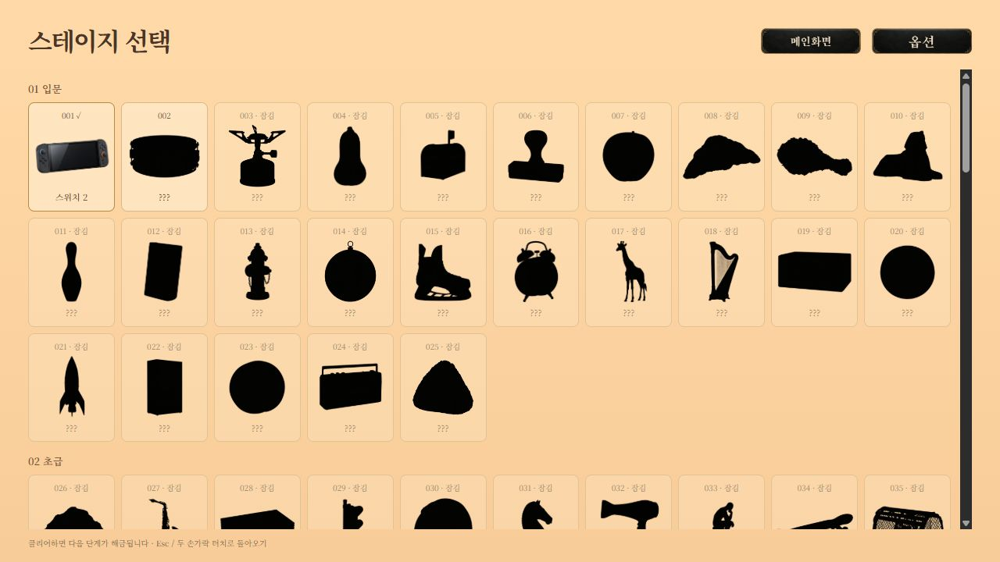
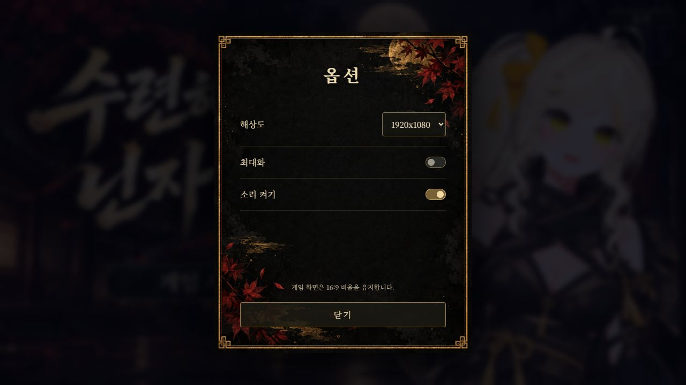

# 수련해라! 닌자 나월!

《수련해라! 닌자 나월!》은 떨어지는 초승달 브로치를 펀치로 날려 기상천외한 사물에 꽂는 물리 퍼즐 팬게임입니다. 타이밍과 회전을 맞춰 150개의 스테이지에 도전하고, 클리어할 때마다 새로운 사물을 공개해 보세요!

[웹에서 바로 플레이](https://intpeditor.github.io/ninja-nawol-night/) · [Windows 앱 다운로드](https://github.com/INTPEDITOR/ninja-nawol-night/releases/latest)


## Windows 앱 다운로드

[최신 릴리스](https://github.com/INTPEDITOR/ninja-nawol-night/releases/latest)에서 `Ninja-Nawol-Night-Windows.zip`을 받은 뒤 **압축을 모두 풀고 `닌자나월.exe`를 실행**하세요. EXE, DLL, game 폴더를 함께 보관해야 합니다. Windows 64비트와 Microsoft Edge WebView2 Runtime이 필요합니다.

## 조작

- 마우스 클릭: 왼쪽에서 마우스 방향으로 팔을 뻗어 떨어지는 브로치를 펀치합니다. 주먹은 브로치 낙하 구간까지만 뻗었다가 돌아옵니다.
- **R: 다시 떨어뜨리기.** 놓친 뒤에도 게임은 계속 동작하며, 클릭·우클릭으로는 재시작하지 않습니다.
- Esc: 스테이지 선택으로 돌아갑니다.
- 성공 화면 클릭: 다음 스테이지로 넘어갑니다.

초승달의 뾰족한 두 끝은 충돌 속도와 각도에 따라 꽂히고, 둥근 부분은 튕깁니다. 사물 위에 안정적으로 얹혀도 성공입니다. 뒤로 갈수록 더 빠르고 정확한 충돌이 필요하며, 장애물·움직이는 표적·바람이 추가됩니다.

클리어하면 다음 스테이지가 순서대로 해금됩니다. 이전 단계도 다시 플레이할 수 있고, 클리어 전에는 `???`와 검은 실루엣이 표시됩니다. 진행과 설정은 이 PC에 자동 저장됩니다.

## 화면과 소리

옵션에서 1920×1080 / 1600×900 / 1280×720 / 960×540, 최대화, 소리 켜기·끄기를 선택합니다. 게임 화면은 16:9를 유지합니다. 메인화면에는 자체 제작한 닌자풍 BGM, 성공 전시 화면에는 사용자가 제공한 음악이 재생됩니다. 게임 시작·다음 단계로 이동할 때 해당 음악이 멈춥니다. 버튼·펀치·충돌 효과음도 포함됩니다.




## 브라우저에서 실행

저장소를 내려받고 Python이 설치된 상태에서 실행합니다.

```sh
python -m http.server 8766 --bind 127.0.0.1 --directory game
```

브라우저에서 <http://127.0.0.1:8766/>에 접속하세요. 브라우저 정책에 따라 음악은 첫 클릭 후 시작할 수 있습니다. 해상도 변경·최대화는 Windows 앱에서 가장 정확히 적용됩니다.

## Windows 앱 빌드

Windows PowerShell에서 다음을 실행하세요. 스크립트가 공식 Microsoft WebView2 SDK를 내려받아 .NET Framework C# 컴파일러로 앱을 빌드합니다.

```powershell
powershell -ExecutionPolicy Bypass -File desktop/build.ps1
```

결과는 `dist/닌자나월/`과 `dist/닌자나월-Windows.zip`에 저장됩니다. 배포 시 폴더 전체 또는 ZIP을 사용하세요.

## 구성과 검증

- `game/`: 브라우저 게임, 150개 레벨 데이터, 이미지·음악·글꼴
- `desktop/`: Windows 실행 파일 소스와 빌드 스크립트
- `docs/`: 타이틀 및 실제 화면
- `game/검증결과.json`: 150개 스테이지의 성공 입력 기록과 최근 판정 검증

Matter.js 물리 엔진, 이미지의 불투명 영역을 반영한 충돌체, 고정 시간 간격의 물리 계산을 사용합니다. 150개 스테이지의 성공 경로, 두 끝의 충돌 판정, 둥근 면 반발, 낙하 후 지속 동작, R키 재시작, 음악 정지와 음소거, Windows 실행을 확인했습니다.

## 에셋 및 라이선스

원본 닌자 캐릭터와 초승달 브로치는 사용자가 제공한 PNG를 그대로 사용합니다. 사물·메뉴 이미지는 이 게임을 위해 제작했습니다. 팬게임이며 관련 권리자와 공식적인 관계가 없습니다. 포함된 이미지·음악을 임의로 별도 재배포하는 권한을 부여하지 않습니다.

Matter.js는 `game/LICENSE-Matter.txt`, Noto Serif KR 글꼴은 `game/LICENSE-NotoSerifKR.txt`를 확인하세요. Microsoft WebView2 SDK의 LICENSE와 NOTICE는 Windows 빌드 결과에 동봉됩니다.
